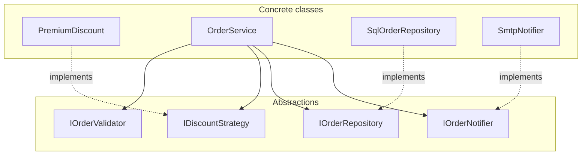

# Order Management · SOLID, side by side

Two ASP.NET Core 10 applications with the **same API and the same UI**, built to show what
SOLID violations look like in real code — and what the corrected design looks like.

| Project | Purpose | URL |
|---|---|---|
| `src/OrderManagement.V1.Bad` | Deliberately violates **all five** SOLID principles (teaching material) | http://localhost:5081 |
| `src/OrderManagement.V2.Good` | The same features, corrected and tested | http://localhost:5082 |
| `tests/OrderManagement.V2.Good.Tests` | 17 tests that run V2 with no database and no SMTP | `dotnet test` |

> ⚠️ **V1 is intentionally insecure.** It contains SQL injection, swallowed exceptions and
> a shared mutable cache. It exists to be studied, never deployed.

---

## Quick start

Requires the **.NET 10 SDK**.

```powershell
# from the demo folder
dotnet build
dotnet test

# start both versions side by side
.\scripts\run-both.ps1

# ...or start them separately
dotnet run --project src/OrderManagement.V1.Bad     # http://localhost:5081
dotnet run --project src/OrderManagement.V2.Good    # http://localhost:5082
```

Then open <http://localhost:5081> and <http://localhost:5082> and run the same actions in
both. The differences are immediate: V1 returns `500` where V2 returns `200`, `400` or `409`.

Orders are persisted to local SQLite files (`orders-v1.db`, `orders-v2.db`).
Reset the demo with `.\scripts\reset-databases.ps1`.

---

## The final architecture (V2)

This is the picture the corrected version implements:



Every arrow from `OrderService` points at an abstraction. The concrete classes are wired
once, in `Program.cs` (the composition root). `OrderService` has never heard of SQLite or SMTP.

There is also `IDiscountStrategyProvider`, which maps a tier to a strategy. That is the only
place that knows *which* policy serves *which* customer — a new tier never touches
`OrderService`.

---

## Same behaviour, opposite structure

| Feature | V1 (bad) | V2 (good) |
|---|---|---|
| Create order | `OrderManager.CreateOrder` — validates, prices, saves, e-mails, logs | `OrderService.CreateAsync` orchestrates 4 collaborators |
| Validation | inline `if` statements in the service | `IOrderValidator` + composable `IOrderValidationRule`s |
| Discounts | `if/else` on a magic string | `IDiscountStrategy` per tier, resolved by a provider |
| Persistence | `new SqliteConnection` inside the service, concatenated SQL | `SqlOrderRepository : IOrderRepository`, parameterised, async |
| Notifications | `new SmtpClient` inside the service, `catch { }` | `IOrderNotifier` + `SmtpNotifier` / `AuditLogNotifier` composite |
| Refunds | `RefundOrder : Order` that throws | `Order.Refund()` on the aggregate |
| Cash on delivery | `CashOnDeliveryProcessor : PaymentProcessor` that throws | `IPaymentProcessor` returning `DueOnDelivery` |
| Wiring | `new OrderManager()` in each endpoint | constructor injection, `Program.cs` |
| Tests | need a real DB + SMTP | 17 fast tests with in-memory fakes |

---

# The five violations

## 1. SRP — the god class

`src/OrderManagement.V1.Bad/Services/OrderManager.cs`

One class does **six** unrelated jobs:

```csharp
public Order CreateOrder(Order order)
{
    // 1. validation
    if (string.IsNullOrWhiteSpace(order.CustomerName) /* ... */) throw new Exception(...);

    // 2. discount policy (tier if/else)

    // 3. tax policy (magic 0.08)

    // 4. persistence (concatenated INSERT)

    // 5. e-mail (SmtpClient)

    // 6. logging (Console.WriteLine)
}
```

It also runs DDL **in its constructor**, so every HTTP request executes
`CREATE TABLE IF NOT EXISTS`:

```csharp
public OrderManager()
{
    GlobalState.EnsureDatabase();   // on every request
}
```

Why it hurts:

- six independent reasons to change (pricing, tax, schema, e-mail, logging, API);
- no way to test pricing without touching SQLite and SMTP;
- a change to the e-mail subject can break order creation.

**V2 fix:** `OrderService` only orchestrates. Validation, pricing, persistence and
notification each live in their own type with their own tests. The schema is created once
at startup by `DatabaseInitializer`.

---

## 2. OCP — the `if/else` that knows the future

`src/OrderManagement.V1.Bad/Services/OrderManager.cs`

```csharp
if (tier == "premium")       percent = 10m;
else if (tier == "vip")      percent = 20m;
// "gold" silently falls through and the customer pays full price
```

Adding a tier means editing: the pricing method, the API documentation, the tests, and
(if you remember) every other `switch` on the same string. The notification channel has the
same problem:

```csharp
switch (channel)          // "push", "whatsapp", "webhook"... edit me again
{
    case "email": SendEmail(...); break;
    case "sms":   SendSms(...);   break;
    default: throw new Exception("Unknown notification channel");
}
```

**V2 fix:** one class per policy, resolved through DI.

```csharp
public sealed class PremiumDiscount : IDiscountStrategy
{
    private const decimal Rate = 0.10m;

    public bool AppliesTo(CustomerTier tier) => tier == CustomerTier.Premium;

    public decimal CalculateDiscount(Order order) =>
        decimal.Round(order.ItemsTotal * Rate, 2, MidpointRounding.AwayFromZero);
}
```

Adding **Gold** = one new class + `AddScoped<IDiscountStrategy, GoldDiscount>()`.
`OrderService`, the validator and the API do not change.

---

## 3. LSP — the subtypes that lie

Two coded examples, both realistic.

### 3a. `RefundOrder : Order`

`src/OrderManagement.V1.Bad/Domain/Order.cs`

```csharp
public class Order
{
    public virtual void AddItem(OrderItem item) => Items.Add(item);
}

public class RefundOrder : Order          // "a refund is an order, right?"
{
    public override void AddItem(OrderItem item) =>
        throw new NotSupportedException("Refund orders cannot contain items.");

    public override decimal CalculateTotal() => -base.CalculateTotal();
}
```

`OrderManager.RefundOrder` is written against `Order`. It works for every order — until it
receives a `RefundOrder`:

```csharp
foreach (var item in original.Items)
    refund.AddItem(item);      // 💥 500: "Refund orders cannot contain items."
```

### 3b. `CashOnDeliveryProcessor : PaymentProcessor`

`src/OrderManagement.V1.Bad/Domain/PaymentProcessor.cs`

```csharp
public abstract class PaymentProcessor
{
    public abstract string Process(decimal amount);   // contract: charge the money now
}

public class CashOnDeliveryProcessor : PaymentProcessor
{
    public override string Process(decimal amount) =>
        throw new NotSupportedException("Cash on delivery cannot be charged up front.");
}
```

Every caller that accepts a `PaymentProcessor` is one `"cod"` value away from a 500.

**V2 fixes:**

- No subtype for refunds. A refund is a **state transition** on the same aggregate:
  `Order.Refund()`, guarded by the state machine. The API returns the same order with
  `status: "Refunded"`.
- The payment contract tells the truth: `ProcessAsync` returns a `PaymentReceipt` whose
  `Settlement` is `Captured` **or** `DueOnDelivery`. Cash on delivery is a legal result,
  not an exception.
- Illegal transitions are rejected by the domain: cancelling twice returns `409` instead of
  silently succeeding.

---

## 4. ISP — the ten-member interface

`src/OrderManagement.V1.Bad/Services/IOrderOperations.cs`

```csharp
public interface IOrderOperations
{
    void SaveOrder(Order order);
    Order? GetOrder(Guid id);
    List<Order> GetAllOrders();
    void SendEmail(string to, string subject, string body);
    void SendSms(string to, string message);
    string GeneratePdfReceipt(Guid orderId);
    void ImportFromCsv(string filePath);
    void ExportToExcel(string filePath);
    void SyncInventory();
    void PrintInvoice(Guid orderId);
}
```

`SalesReportService` needs exactly one member (`GetAllOrders`) but is forced to depend on
ten. `OrderManager` implements five of them by throwing `NotImplementedException`.

**V2 fix:** narrow, cohesive contracts:

```csharp
public interface IOrderRepository
{
    Task AddAsync(Order order, CancellationToken cancellationToken = default);
    Task<Order?> GetByIdAsync(Guid id, CancellationToken cancellationToken = default);
    Task<IReadOnlyList<Order>> GetAllAsync(CancellationToken cancellationToken = default);
    Task UpdateAsync(Order order, CancellationToken cancellationToken = default);
}
```

`SalesReportService` takes `IOrderRepository`; its test can fake it in four lines.
The PDF/CSV/inventory methods are not "order" concerns and do not belong in the same
interface — if they are ever needed, they get their own ports.

---

## 5. DIP — `new` in the constructor

`src/OrderManagement.V1.Bad/Program.cs`

```csharp
app.MapPost("/api/orders", (CreateOrderRequest request) =>
{
    var order = new OrderManager().CreateOrder(Map(request));   // ❌ no seam
    ...
});
```

`OrderManager` then reaches for its own infrastructure:

```csharp
using var connection = new SqliteConnection(GlobalState.ConnectionString);  // ❌
using var client = new SmtpClient("localhost", 25);                         // ❌
```

The policy layer depends on the details, the connection string is a static field, and the
global cache is shared by every request. Nothing can be substituted.

**V2 fix:** dependency inversion + composition root.

```csharp
public OrderService(
    IOrderRepository orders,
    IOrderValidator validator,
    IDiscountStrategyProvider discounts,
    IPaymentProcessorProvider payments,
    IOrderNotifier notifier,
    TimeProvider clock,
    ILogger<OrderService> logger)
```

```csharp
// Program.cs
builder.Services.AddScoped<IOrderRepository, SqlOrderRepository>();
builder.Services.AddScoped<IOrderNotifier>(sp => new CompositeOrderNotifier(
    sp.GetRequiredService<SmtpNotifier>(),
    sp.GetRequiredService<AuditLogNotifier>()));
```

`TimeProvider` is injected too, which is why the tests can assert `CreatedAt` exactly.

---

## Bonus smells in V1 (not SOLID, still instructive)

| Smell | Where | V2 treatment |
|---|---|---|
| SQL injection | `SaveOrder` concatenates the customer name | parameterised `$name`, see `SqlOrderRepository` |
| `O'Brien` crashes the app | same | covered by `requests.http` |
| Every user mistake is a `500` | endpoint `catch (Exception)` | 400 / 404 / 409 via `ApiExceptionHandler` |
| Exception text leaked to clients | `Results.Problem(ex.Message, 500)` | safe `ProblemDetails` with a title and validation errors |
| SMTP failure swallowed | `catch (Exception) { }` in `SendEmail` | notifier throws or logs; dev outbox when SMTP is off |
| Global mutable cache | `GlobalState.Cache` | none; the repository is the only state |
| DDL on every request | `OrderManager` constructor | `DatabaseInitializer` at startup |
| `DateTime.Now` | `Order.CreatedAt` | `TimeProvider.GetUtcNow()` |
| No item validation | quantity `0` or `-5` accepted | `ItemsRule` (1..100, price > 0, SKU/name) |
| Domain serialized to the wire | endpoints return `Order` | `OrderResponse` DTOs |
| Sync blocking I/O | `Open()`, `ExecuteNonQuery()`, `Send()` | async all the way with `CancellationToken` |
| Public setters everywhere | `Order` is a data bag | private setters + aggregate methods |

---

## The 2-minute demo script

Run both apps, then repeat these steps in each UI.

| Experiment | V1 (5081) | V2 (5082) |
|---|---|---|
| Create the prefilled Premium order | `201`, 10% off, 8% tax | `201`, identical totals |
| Customer name `O'Brien` | `500` — SQLite syntax error | `201` — stored correctly |
| Press **Refund** | `500` — "Refund orders cannot contain items." | `200` — status `Refunded` |
| Press **Pay · cash on delivery** | `500` — "Cash on delivery cannot be charged up front." | `200` — `DueOnDelivery` |
| Tier **Gold** | `201` — silently 0% discount | `400` — "Unknown customer tier 'Gold'." |
| Item quantity `0` plus a valid second item | `201` — the zero line is stored | `400` — item-level message |
| **Cancel** twice | `200`, then `200` | `200`, then `409` |

Expected V2 pricing for the prefilled order (2 × 120, Premium):

```
subtotal   240.00
discount   -24.00   (10%)
tax        +17.28   (8% of 216)
total      233.28
```

---

## API reference (identical in both versions)

| Method | Route | Body | Notes |
|---|---|---|---|
| `GET` | `/api/orders` | – | list, newest first |
| `GET` | `/api/orders/{id}` | – | `404` when unknown |
| `POST` | `/api/orders` | customer + items | `201` |
| `POST` | `/api/orders/{id}/cancel` | – | `200` / `404` / `409` |
| `POST` | `/api/orders/{id}/refund` | – | `200` / `404` / `409` |
| `POST` | `/api/orders/{id}/pay` | `{ "method": "card" \| "cod" }` | receipt |
| `GET` | `/api/reports/sales` | – | counts, revenue, discounts |

```json
{
  "customer": { "name": "Ada Lovelace", "email": "ada@example.com", "tier": "Premium" },
  "items": [
    { "sku": "KB-01", "name": "Mechanical keyboard", "unitPrice": 120, "quantity": 2 }
  ]
}
```

Tiers: `Standard` (0%), `Premium` (10%), `Vip` (20%).
Tax: 8% of the discounted subtotal, rounded half-away-from-zero to 2 decimals.

Ready-to-run requests live in each project's `requests.http`.

---

## Extending V2 (the point of all this)

| Change | V1 work | V2 work |
|---|---|---|
| New customer tier | edit the discount `if/else`, the string comparisons, docs and tests | add `GoldDiscount`, one DI line, add the enum value |
| New notification channel | edit the `switch`, the fat interface, every fake | add `SmsNotifier : IOrderNotifier`, one DI line, include it in the composite |
| New payment method | edit the endpoint and the base class | add `PayPalProcessor : IPaymentProcessor`, one DI line |
| Swap SQLite for SQL Server | rewrite parts of `OrderManager` | new `IOrderRepository` implementation, one DI line |
| Unit test pricing | real DB + SMTP | `new OrderService(...)` with fakes |

Example — a new payment method, no service edits:

```csharp
public sealed class PayPalProcessor : IPaymentProcessor
{
    public string Method => "paypal";

    public Task<PaymentReceipt> ProcessAsync(Order order, CancellationToken ct = default) =>
        Task.FromResult(new PaymentReceipt("PP-" + Guid.NewGuid().ToString("N")[..10],
                                           order.Total, PaymentSettlement.Captured));
}

// Program.cs
builder.Services.AddScoped<IPaymentProcessor, PayPalProcessor>();
```

---

## Tests

```powershell
dotnet test
```

17 tests, ~0.1 s, no infrastructure:

- **Pricing** — Premium 10%, VIP 20%, Standard 0%, injected clock.
- **Validation** — empty order, bad e-mail + quantity, minimum value, and "invalid orders
  are never persisted or announced".
- **State machine** — cancel, cancel twice, refund, refund after cancel, unknown id.
- **Payments** — card captured, COD deferred, unknown method rejected.
- **Reporting** — cancelled and refunded orders do not inflate revenue.

The V1 equivalent would need a real SQLite file and a real SMTP server for almost every case.

---

## Project layout

```
demo/
├─ OrderManagement.slnx
├─ scripts/
│  ├─ run-both.ps1
│  └─ reset-databases.ps1
├─ src/
│  ├─ OrderManagement.V1.Bad/            # "how not to do it"
│  │  ├─ Domain/Order.cs                 # Order + RefundOrder (LSP)
│  │  ├─ Domain/PaymentProcessor.cs      # CashOnDeliveryProcessor (LSP)
│  │  ├─ Infrastructure/GlobalState.cs   # static DB + cache
│  │  ├─ Services/IOrderOperations.cs    # fat interface (ISP)
│  │  ├─ Services/OrderManager.cs        # god class (SRP/OCP/DIP)
│  │  ├─ Services/SalesReportService.cs  # forced to depend on 10 methods
│  │  ├─ wwwroot/index.html
│  │  └─ Program.cs                      # new OrderManager() everywhere
│  └─ OrderManagement.V2.Good/           # the corrected design
│     ├─ Abstractions/Abstractions.cs    # the four ports (+ providers)
│     ├─ Domain/Order.cs                 # aggregate + state machine
│     ├─ Discounts/DiscountStrategies.cs # Standard / Premium / Vip
│     ├─ Validation/                     # rules + composing validator
│     ├─ Services/OrderService.cs        # orchestration only
│     ├─ Infrastructure/                 # SqlOrderRepository, notifiers
│     ├─ Api/                            # DTOs, endpoints, exception mapping
│     ├─ wwwroot/index.html
│     └─ Program.cs                      # composition root
└─ tests/
   └─ OrderManagement.V2.Good.Tests/     # 17 tests, fakes, no infra
```

The two apps share no code on purpose: V1 is a cautionary tale, and nothing from it should
leak into V2. The duplicated `index.html` keeps each app runnable on its own.

---

## Notes

- **Tax** is a single constant in `OrderService` to keep the example focused. In a real
  system it is another strategy (`ITaxPolicy`) — the OCP mechanics are identical to discounts.
- **E-mail** is disabled by default (`Notifications:UseSmtp = false`): messages go to the
  dev outbox in the logs, and `AuditLogNotifier` appends to `notifications.log`.
  V1 always tries `localhost:25` and silently swallows the failure — that is the lesson.
- **SQLite** keeps the demo self-contained. The repository boundary is the only place that
  would change for SQL Server or PostgreSQL.
- V1's SQL injection is real. Do not run it against anything you care about.
